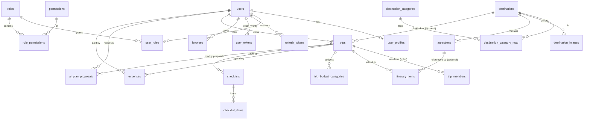

# TravelMate — Database

PostgreSQL 16 + PostGIS in production (`postgres` profile); H2 in PostgreSQL mode for local
development (`local`) and tests (`test`). Schema is owned by Flyway; Hibernate never generates DDL
(`ddl-auto: none`).

| Location | Runs on | Contents |
|---|---|---|
| `db/migration/common/V1__core_schema.sql` | all | Tables, constraints, indexes |
| `db/migration/common/V2__roles_and_permissions.sql` | all | Roles, permissions, role→permission map |
| `db/migration/common/V3__seed_destinations.sql` | all | **Seed data** (`is_seed_data = TRUE`): 17 categories, 10 destinations, 66 attractions, gallery images |
| `db/migration/postgresql/R__postgis_and_search_indexes.sql` | postgres only | PostGIS + pg_trgm extensions, `geog` generated columns, GiST and trigram indexes |

Portable SQL only in `common`: `UUID`, `VARCHAR(n)` (no `TEXT`, which H2 maps to CLOB), `NUMERIC`,
`BOOLEAN`, `DATE`, `TIME`, `TIMESTAMP WITH TIME ZONE`. JSON blobs are stored as `VARCHAR` text.

## Conventions

- Primary keys: `UUID`, generated by the application.
- Every table has `created_at` and `updated_at` (`TIMESTAMP WITH TIME ZONE`, UTC).
- Money: `NUMERIC(12,2)` plus a `currency VARCHAR(3)` (ISO 4217) column. Never floating point.
- Coordinates: `NUMERIC(9,6)` latitude/longitude; PostGIS `geography(Point,4326)` is derived in Postgres.
- Soft deletion (`deleted_at`) for user-owned or published content: destinations, attractions, trips,
  itinerary items, expenses.
- Optimistic locking (`version BIGINT`) on rows edited concurrently or offline later: users, destinations,
  trips, itinerary items, expenses.
- Enumerations are `VARCHAR` with `CHECK` constraints (status, role, category).

## Relationships

## Tables

### Identity & access
| Table | Key columns | Notes |
|---|---|---|
| `users` | `email` (unique), `password_hash` (BCrypt 12), `status` ACTIVE/SUSPENDED, `last_login_at`, `version` | Emails stored lower-case |
| `user_profiles` | `user_id` PK/FK, `home_city`, `bio`, `preferred_currency`, `travel_styles` (comma list) | 1:1 with users |
| `roles`, `permissions`, `role_permissions`, `user_roles` | names as keys | Code checks permissions only |
| `refresh_tokens` | `token_hash` (SHA-256, unique), `family_id`, `expires_at`, `revoked_at`, `replaced_by` | Rotation; reuse of a revoked token revokes the family |
| `user_tokens` | `purpose` PASSWORD_RESET/EMAIL_VERIFY, `token_hash`, `expires_at`, `used_at` | One-time |
| `audit_logs` | `actor_id`, `actor_email`, `action`, `target_type`, `target_id`, `details` | Append-only; written in its own transaction |

### Catalogue
| Table | Key columns | Notes |
|---|---|---|
| `destination_categories` | `slug` unique, `sort_order` | |
| `destinations` | `slug` unique, lat/lng, `budget_per_day_min/max` (per person, estimate), `travel_tips` (pipe-separated), `faqs` (JSON text), `status` DRAFT/PUBLISHED, `featured`, `is_seed_data`, `popularity` | Only PUBLISHED and not deleted are public |
| `destination_category_map` | (`destination_id`, `category_id`) | M:N |
| `destination_images` | `url`, `credit`, `alt`, `sort_order` | Hero is also `destinations.hero_image_url` |
| `attractions` | (`destination_id`, `slug`) unique, `category`, lat/lng, `typical_duration_minutes`, `cost_min/max` per person, `best_time_of_day`, `opening_hours_verified`, `tags`, `family_friendly` | Planner catalogue |
| `favorites` | (`user_id`, `target_type`, `target_id`) unique | DESTINATION or ATTRACTION |
| `search_queries` | `query` | Anonymous; used only for popular searches |

### Trips
| Table | Key columns | Notes |
|---|---|---|
| `trips` | `owner_id`, `destination_id` (nullable) + `destination_name`, dates, `day_count` 1–60, `travelers`, `budget_amount`, `currency`, `status`, `archived`, `version` | `end_date >= start_date` check |
| `trip_members` | (`trip_id`, `user_id`) unique, `role` OWNER/CO_PLANNER/TRAVELER/VIEWER | Phase 1 creates OWNER only |
| `itinerary_items` | `day_number`, `position`, times, `duration_minutes`, `estimated_cost` + `cost_is_estimate`, `status`, `locked`, `source` USER/AI/PLANNER, `ai_reason`, `attraction_id`, `version` | Index on (trip, deleted, day, position) |
| `trip_budget_categories` | (`trip_id`, `category`) PK, `amount` | Optional per-category budgets |
| `expenses` | `amount` > 0, `currency`, `category`, `paid_by_user_id`, `expense_date`, `client_request_id` | (`trip_id`, `client_request_id`) unique for idempotent offline retries |
| `checklists`, `checklist_items` | `template_key`, `completed`, `suggested`, `reason` | |
| `ai_plan_proposals` | `user_id`, `trip_id` (for modify), `engine`, `payload` (JSON text), `applied_at` | Nothing reaches a trip until applied |

## Phase 2+ tables (planned, not yet created)

`trip_invitations`, `trip_votes`, `conversations`, `messages`, `expense_participants`, `settlements`,
`documents`, `notifications`, `memories`, `trip_photos`, `providers`, `provider_services`,
`provider_documents`, `provider_availability`, `bookings`, `booking_participants`, `payments`,
`refunds`, `payouts`, `commissions`, `reviews`, `subscriptions`, `coupons`, `support_tickets`,
`support_messages`. Each lands with its phase as a new versioned migration.
